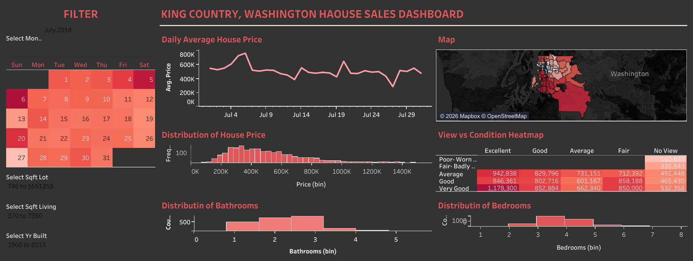

# King County House Price Dashboard

**Live dashboard:** [Tableau Public](https://public.tableau.com/views/DashboardHousePrice/Dashboard1)



An interactive Tableau dashboard that helps a real estate agency in King County, Washington answer one question:

> **What drives a home's sale price, and how should sellers and buyers use that to price and time a sale?**

---

## 1. Business problem

Agents in King County price listings and advise buyers every day. Pricing too high leaves a home on the market; pricing too low leaves money on the table. Buyers on a budget also need to know where and when they can get the most house for their money.

The dashboard breaks the main question into four sub-questions:

| # | Question | Dashboard view |
|---|----------|----------------|
| 1 | What does a typical home sell for? | Price distribution |
| 2 | Does timing matter? | Calendar filter + price trend |
| 3 | How much does location matter? | Map of price by zip code |
| 4 | Which property features move the price? | View × condition heatmap, bedroom and bathroom views, filters for living area, lot size and year built |

## 2. Data

- **Source:** [House Sales in King County, USA](https://www.kaggle.com/datasets/harlfoxem/housesalesprediction) (Kaggle)
- **Scope:** 21,613 home sales between 2 May 2014 and 27 May 2015 across 70 zip codes
- **Fields used:** sale date, price, living area, lot size, bedrooms, bathrooms, view (0–4), condition (1–5), construction grade (1–13), waterfront, year built, zip code, latitude/longitude

### Data preparation

| Issue found | Decision |
|-------------|----------|
| A small number of luxury sales pull averages up | Excluded the 535 sales above about $1.49M (2.5% of sales) and used **median** price instead of mean |
| View and condition stored as numbers | Mapped to readable labels (e.g. condition 3 = Average, view 0 = No View) |
| One house listed with 33 bedrooms but only 1,620 sq ft | Flagged as a likely data-entry error |
| 177 houses sold more than once in the period | Kept as separate sales, since each is a real transaction |
| Very few sales on weekends (2.4% of all sales) | Daily figures on weekends rest on a handful of sales, so trends are read monthly |

## 3. Key findings

All figures exclude sales above about $1.49M. They can be reproduced with [`analysis/verify_findings.py`](analysis/verify_findings.py).

**1. A typical home sold for $445,000.**
Half of all sales fell between $320,000 and $625,000. The mean ($500,000) sits well above the median, confirming that prices are right-skewed and the median is the fairer benchmark.

**2. Spring is the seller's market.**
The median price rose from $425,000 in February 2015 to $468,000 in April 2015 (+10%), and sales volume more than doubled, from 947 in January to 2,177 in April. Winter months combine lower prices with far fewer competing buyers.

**3. Location is the biggest single lever.**
Median prices ranged from $925,000 in zip code 98040 to $235,000 in 98002 and 98168, a 3.9× gap. Even per square foot, location still triples the price: $437/sq ft in 98004 versus $145/sq ft in 98023.

**4. Size and build quality drive price; condition barely does.**
Living area and construction grade show the strongest relationship with price (correlation 0.66 each). Moving from grade 7 to grade 8 raises the median price from $375,000 to $510,000 (+36%). Condition shows almost no relationship (correlation 0.04): homes rated Good sold for slightly less than homes rated Average.

**5. View matters more than condition.**
Homes with an Excellent view sold for a median of $912,500, more than double the $430,000 for homes with no view. The view × condition heatmap shows the price rising across view ratings far more than down condition ratings.

**6. More bedrooms raise the price, but each square foot gets cheaper.**
The median price rises from $410,000 for 3 bedrooms to $535,000 for 4, but the price per square foot falls from $243 to $225, and to $198 for 6 bedrooms.

## 4. Recommendations

1. **Time listings for March to June.** Sellers face the highest prices and the most buyers in spring. Buyers looking for a deal should shop between November and February.
2. **Price by location and living area, not bedroom count.** Start from the zip code's median price per square foot, multiply by living area, then adjust for grade and view.
3. **Advise sellers to invest in build quality and finish, not cosmetic fixes.** Grade is linked to much higher prices, while condition rating is not. Before turning this into a firm rule, test it on the 177 homes that sold twice in the period.
4. **Point budget buyers to south King County.** Zip codes such as 98002, 98023, 98032 and 98001 sell at around $145–150 per square foot, about one-third of the price in Bellevue (98004).

## 5. Dashboard features

- **Calendar filter:** choose a month from the dropdown and a date from the calendar
- **Range filters:** living area, lot size and year built, so an agent can compare homes similar to a listing
- **Map:** house prices by zip code
- **View × condition heatmap:** average price for each combination of view and condition rating
- **Distributions:** price, bedrooms and bathrooms

## 6. Limitations

- The data covers one year (2014–2015), so prices are far below today's levels. The patterns, not the dollar amounts, are what carry over.
- Correlation is not causation. A higher grade may stand in for neighbourhood or size, not cause a higher price on its own.
- Luxury homes above about $1.49M are excluded, so findings apply to the mainstream market.
- Grade, condition and view are assessor ratings, not independent measurements.

## 7. How to reproduce

```bash
pip install pandas
# download kc_house_data.csv from Kaggle into data/
python analysis/verify_findings.py data/kc_house_data.csv
```

## Tools

Tableau Public · Python (pandas) for validation

---

**Author:** Nabila Karima Azka · [Portfolio](https://nabilakarimaazka.github.io) · [LinkedIn](https://linkedin.com/in/nabilakarima)
